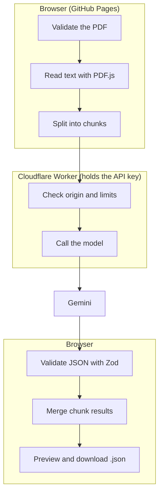

# PDF Insight

A web app that reads a PDF, writes a short summary (3–5 sentences, in the document's language) and turns the content into structured JSON. You can preview the result and download it as a `.json` file.

**Demo:** https://yilyaa.github.io/pdf-insight/ (GitHub Pages)

> **Status:** done so far: data schema, normalisation, chunking of long documents, result merging, PDF reading with scan detection. In progress: AI proxy (Cloudflare Worker), user interface, deployment. A screenshot is added at the end.
>
> The user interface is in Polish on purpose: the task brief requires Polish messages.

## How it works

GitHub Pages serves static files only, so AI calls go through a small proxy that holds the API key. The browser never sees the key.



Steps in the browser:

1. **File validation.** PDF only, checked by the `%PDF-` header and not just the extension. Maximum 10 MB.
2. **Text extraction** page by page with PDF.js. A page with fewer than 30 characters is treated as a scan and read as an image.
3. **Chunking** of long documents, then **merging** of the results (deduplication, field limits).
4. **Response validation** with a Zod schema. On a malformed answer: one retry, then an error message.

The Worker checks the request origin (CORS allows only the demo domain), the body size and the request rate. PDF content is treated as data, never as instructions (prompt injection defence).

## Data schema

```json
{
  "document": {
    "fileName": "contract.pdf",
    "pages": 4,
    "language": "pl",
    "type": "umowa",
    "title": "Umowa serwisowa",
    "date": "2026-09-01"
  },
  "summary": "…",
  "keyPoints": ["…"],
  "entities": { "organizations": ["…"], "people": [] },
  "amounts": [{ "value": 12500.0, "currency": "PLN", "context": "wynagrodzenie" }],
  "dates": [{ "date": "2026-10-01", "context": "termin płatności" }],
  "keywords": ["…"]
}
```

Rules: missing information is `null` or `[]` (the model must not guess), dates are ISO 8601, currencies ISO 4217, keys in English, values in the document's language. `type` is one of `faktura`, `umowa`, `oferta`, `raport`, `inne`. Schema: [src/lib/schema.ts](src/lib/schema.ts).

## Stack

React 18+ · Vite · TypeScript (`strict`) · Zod · PDF.js · Vitest · ESLint + Prettier · Cloudflare Workers · GitHub Actions (lint → build → deploy).

## Project structure

```
src/components/   user interface
src/lib/          schema, normalisation, PDF reading, chunking, merging
src/api/          proxy client
worker/           AI proxy (Cloudflare Worker)
tests/            unit tests and generated test PDFs (tests/fixtures/generated)
design/spec.md    interface design: flows, states, tokens, copy
docs/plan.md      architecture, stages, edge-case matrix
```

## Run locally

```bash
npm install
cp .env.example .env     # VITE_API_URL = proxy address (not a secret)
npm run dev
npm test                 # unit tests
npm run lint && npm run build
```

Environment variables:

| Variable | Where | Secret? |
|---|---|---|
| `VITE_API_URL` | frontend (Actions variable at build time) | no |
| `GEMINI_API_KEY` | Cloudflare Worker (`wrangler secret put`) | **yes**, never in the repository |

## Security

- The API key lives only in Worker secrets. It is not in the frontend or in the Git history.
- CORS is limited to the demo domain. File size and request rate are limited.
- PDF content is data, not instructions. No `dangerouslySetInnerHTML`; results are rendered as text.
- The user is told that the file content is sent to an external AI API. Do not upload confidential documents.

## Error handling and edge cases

Full matrix: [docs/plan.md](docs/plan.md). The main ones:

| Situation | Behaviour |
|---|---|
| Not a PDF, empty, over 10 MB, corrupt, password-protected | Polish message, no request is sent |
| PDF without a text layer (scan), scan mixed with text | scanned pages are read as images |
| Malformed AI answer | one retry, then an error with a retry button |
| Free API quota used up, rate limit, no network, timeout | separate messages, retry button |
| Instructions hidden in the PDF text | ignored (covered by a test fixture) |

## Known limitations

- The free API quota is shared by all demo users. When it runs out, analysis is temporarily unavailable.
- Very long documents may exceed the time limit.
- Scan recognition quality depends on the AI model.

## Working with AI

Tools, key prompts, AI mistakes and how they were fixed: [AI_LOG.md](AI_LOG.md).
