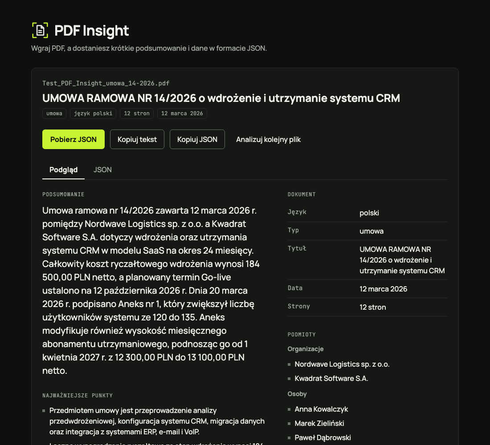
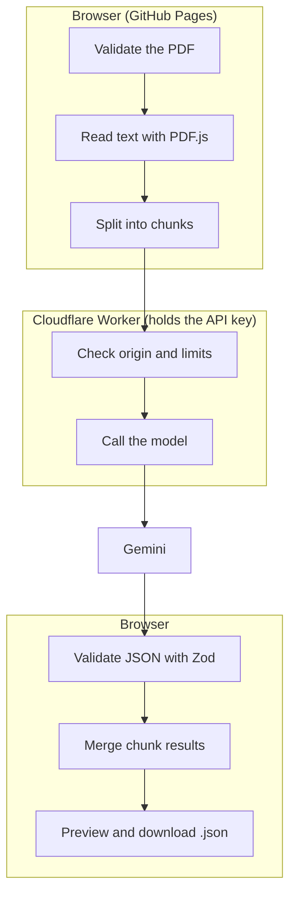

# PDF Insight

A web app that reads a PDF, writes a short summary (3–5 sentences, in the document's language) and turns the content into structured JSON. You can preview the result and download it as a `.json` file.

**Demo:** https://yilyaa.github.io/pdf-insight/ (GitHub Pages)



> The user interface is in Polish on purpose: the task brief requires Polish messages.

**Using it:** drop a PDF (or pick one), wait for the four steps (about 15–40 s depending on length), read the summary and the data, then download the JSON (`Pobierz JSON`) or copy the text or JSON. The last 10 results stay in this browser for 30 days.

## How it works

GitHub Pages serves static files only, so AI calls go through a small proxy that holds the API key. The browser never sees the key.



Steps in the browser:

1. **File validation.** PDF only, checked by the `%PDF-` header and not just the extension. Maximum 10 MB.
2. **Text extraction** page by page with PDF.js. A page with fewer than 30 characters is treated as a scan and read as an image.
3. **Chunking** of long documents, then **merging** of the results (deduplication, field limits).
4. **Response validation** with a Zod schema. On a malformed answer: one retry, then an error message.

The Worker checks the request origin (CORS allows only the demo domain), the body size and the request rate. PDF content is treated as data, never as instructions (prompt injection defence).

## Data schema

```json
{
  "document": {
    "fileName": "contract.pdf",
    "pages": 4,
    "language": "pl",
    "type": "umowa",
    "title": "Umowa serwisowa",
    "date": "2026-09-01"
  },
  "summary": "…",
  "keyPoints": ["…"],
  "entities": { "organizations": ["…"], "people": [] },
  "amounts": [{ "value": 12500.0, "currency": "PLN", "context": "wynagrodzenie" }],
  "dates": [{ "date": "2026-10-01", "context": "termin płatności" }],
  "keywords": ["…"]
}
```

Rules: missing information is `null` or `[]` (the model must not guess), dates are ISO 8601, currencies ISO 4217, keys in English, values in the document's language. `type` is one of `faktura`, `umowa`, `oferta`, `raport`, `inne`. Schema: [src/lib/schema.ts](src/lib/schema.ts).

## Stack

React 18+ · Vite · TypeScript (`strict`) · Zod · PDF.js · Vitest · ESLint + Prettier · Cloudflare Workers · GitHub Actions (lint → build → deploy).

## Project structure

```
src/components/   user interface
src/lib/          schema, normalisation, PDF reading, chunking, merging
src/api/          proxy client
worker/           AI proxy (Cloudflare Worker)
tests/            unit tests and generated test PDFs (tests/fixtures/generated)
design/spec.md    interface design: flows, states, tokens, copy
docs/plan.md      architecture, stages, edge-case matrix
.github/workflows checks (lint, types, tests, build, security) and pages (deploy to GitHub Pages)
```

## Run locally

```bash
npm install
cp .env.example .env     # VITE_API_URL = proxy address (not a secret)
npm run dev
npm test                 # unit tests
npm run lint && npm run typecheck
VITE_API_URL=https://… npm run build
```

`npm run build` stops with an error when `VITE_API_URL` is missing: without it the build would silently drop the analysis code and every upload would fail in the browser. The Worker accepts only the demo origin, so a local page needs a dev proxy that sets that `Origin`, or your own Worker with `ALLOWED_ORIGINS` set to the local address (see `worker/`).

Environment variables:

| Variable | Where | Secret? |
|---|---|---|
| `VITE_API_URL` | frontend (Actions variable at build time) | no |
| `GEMINI_API_KEY` | Cloudflare Worker (`wrangler secret put`) | **yes**, never in the repository |

## Security

- The API key lives only in Worker secrets. It is not in the frontend or in the Git history.
- CORS is limited to the demo domain. This stops other websites in a browser, not scripts: anyone can send a fake `Origin` with `curl`. The real protection of the free quota is the limits: per client (IPv6 counted by /64), one global bucket for all clients, a hard byte cap on the request body (read as a stream), image checks (valid base64, type matches the file header) and a 28 s time budget per request.
- Model output is untrusted too: only known fields are kept, strings and lists are cut to fixed sizes, amounts that cannot be read without guessing (`1.234`) are dropped.
- Prompt-injection defences: the document sits in a tagged block, look-alike closing tags (zero-width, fullwidth, other case) are broken, the file name is reduced to one clean line, and the answer is checked against the schema. The model is not given any tool or secret to leak.
- PDF content is data, not instructions. No `dangerouslySetInnerHTML`; results are rendered as text.
- The user is told that the file content is sent to an external AI API. Do not upload confidential documents.

## Error handling and edge cases

Full matrix: [docs/plan.md](docs/plan.md). The main ones:

| Situation | Behaviour |
|---|---|
| Not a PDF, empty, over 10 MB, corrupt, password-protected | Polish message, no request is sent |
| PDF without a text layer (scan), scan mixed with text | scanned pages are read as images |
| Malformed AI answer | one retry, then an error with a retry button |
| Free API quota used up, rate limit, no network, timeout | separate messages, retry button |
| Instructions hidden in the PDF text | ignored (covered by a test fixture) |

## Limits

| Limit | Value | Where |
|---|---|---|
| File size | 10 MB | browser, checked before any request |
| Requests per run | up to 12, one at a time, at least 6 s apart | browser; a longer document is analysed up to the cap and the result says which pages were covered |
| Scan images | up to 8 per request, each at most 700 000 base64 characters | browser (JPEG quality and size are lowered until it fits) |
| Requests per minute | 10 per IP address | Worker; on `429` the browser waits `Retry-After` and continues |
| Free AI quota | shared by all visitors | Gemini free tier; when it is used up the app shows a separate message |
| Time | one request is cut after 45 s in the browser, 28 s in the Worker | |
| History | 10 results, 30 days, this browser only (`localStorage`), not shared between users | |

## Known limitations

- The free API quota is shared by all demo users. When it runs out, analysis is temporarily unavailable.
- Very long documents may exceed the time limit.
- Scan recognition quality depends on the AI model.
- The Worker cannot tell a real visitor from a script. A determined person can still use the global limit up for a few minutes at a time; a captcha (Cloudflare Turnstile) would close this and is not built.
- A document with a hidden instruction can still make the model write a wrong summary of that document. It cannot change the data shape, other users' results or the app.
- Amounts written like `1.234` or `1,234` are left out because they could mean 1.234 or 1234.
- Scans: pages are rendered in the browser and read by the model; quality depends on the model. Blank pages are detected on the client and not sent. Scan decoding for JPX and JBIG2/CCITT images needs the wasm files that the build copies to `pdfjs/wasm/`.
- Documents longer than the request cap are analysed only up to the cap (the result says `Przeanalizowano strony 1-N z M`).
- A long contract can list dozens of amounts and dates; the lists collapse after 8 items.

## License

MIT, copyright (c) 2026 Illia Yanukovich. You may use and change the code; the copyright notice must stay. See [LICENSE](LICENSE).

## Working with AI

Tools, key prompts, AI mistakes and how they were fixed: [AI_LOG.md](AI_LOG.md).
